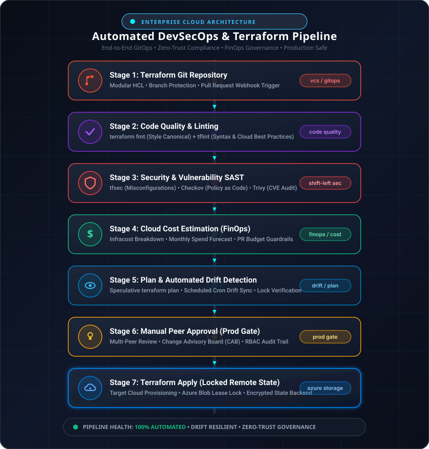

<div align="center">

  <!-- Main Animated Banner -->
  <a href="https://github.com/infovimalsingh01-jpg">
    
  </a>

  <br/><br/>

  <!-- Dynamic Animated Typing Header -->
  <a href="https://github.com/infovimalsingh01-jpg">
    
  </a>

  <br/>

  <!-- Dynamic Badges & Quick Stats -->
  <p align="center">
    <a href="https://github.com/infovimalsingh01-jpg">
      
    </a>
    <a href="https://github.com/infovimalsingh01-jpg">
      
    </a>
    <a href="https://github.com/infovimalsingh01-jpg">
      
    </a>
    <a href="https://github.com/infovimalsingh01-jpg">
      
    </a>
    <a href="https://github.com/infovimalsingh01-jpg">
      
    </a>
    <a href="https://github.com/infovimalsingh01-jpg">
      
    </a>
    <a href="https://github.com/infovimalsingh01-jpg">
      
    </a>
    <a href="https://github.com/infovimalsingh01-jpg">
      
    </a>
  </p>

  <p align="center">
    <a href="https://www.linkedin.com/in/vimal-pratap-singh-102ba93a5/">
      
    </a>
    <a href="https://www.naukri.com/mnjuser/profile?id=&altresid">
      
    </a>
    <a href="mailto:info.vimalsingh01@gmail.com">
      
    </a>
    <a href="https://github.com/infovimalsingh01-jpg?tab=repositories">
      
    </a>
  </p>

</div>

---

### 👨‍💻 Executive Profile & Background

> *"Building resilient, self-healing, and cost-optimized cloud platforms through immutable Infrastructure-as-Code, end-to-end DevSecOps automation, and enterprise-grade Business Intelligence & Data platform engineering."*

> 💼 **Open for Roles:** Senior DevOps Engineer • Cloud Platform Architect • SRE Lead • Enterprise Data Platform Lead  
> 🌐 **Direct Profiles:** [LinkedIn Profile](https://www.linkedin.com/in/vimal-pratap-singh-102ba93a5/) • [Naukri.com Profile](https://www.naukri.com/mnjuser/profile?id=&altresid) • [Email Directly](mailto:info.vimalsingh01@gmail.com)

I am a **Senior DevOps & Cloud Platform Engineer** with **over 5 years of specialized hands-on DevOps/SRE engineering** and **more than 10 years of comprehensive IT infrastructure experience**. 

My core focus centers on architecting enterprise-scale cloud foundations across **Microsoft Azure, Amazon Web Services (AWS), and Google Cloud Platform (GCP)**, packaging production workloads with **Docker**, orchestrating resilient clusters with **Kubernetes (AKS/EKS/GKE)**, engineering declarative **Terraform / Terragrunt** modular architectures, establishing automated **DevSecOps pipelines** embedded with shift-left security audits, continuous drift detection, automated FinOps budget guardrails, and administering enterprise data platforms including **Tableau (Server, Cloud, Bridge)**, **Microsoft SQL Server (MS SQL)**, and **Microsoft Power BI**.

* 🔭 **Specialization:** Enterprise IaC (Terraform), Multi-Cloud Platforms (Azure, AWS, GCP), Containerization (Docker), Kubernetes (AKS/EKS/GKE), GitOps & Site Reliability Engineering (SRE).
* 📊 **Enterprise BI & Data Systems:** End-to-end administration of **Tableau Server**, **Tableau Cloud** SaaS governance, hybrid on-prem-to-cloud automated synchronization via **Tableau Bridge**, enterprise **Power BI** dataflows, and high-availability **Microsoft SQL Server (MS SQL)** database administration.
* 🛡️ **DevSecOps Philosophy:** Zero-trust architecture with integrated SAST scanning (`tfsec`, `Checkov`, `Trivy`) before infrastructure code ever reaches production.
* 💰 **FinOps Integration:** Automated pre-deployment cost estimations using `Infracost` with branch-level budget enforcement.
* ⚡ **Resilience & Governance:** High availability (99.99% target), automated state locking with Azure Blob Storage, and scheduled drift reconciliation.

---

### 🚀 Flagship Architecture: Enterprise Terraform & DevSecOps CI/CD Pipeline

The core framework below illustrates my standardized, battle-tested production pipeline for provisioning enterprise cloud infrastructure with zero drift, comprehensive security checks, financial transparency, and state resilience:

<div align="center">
  
</div>

<br/>

#### 🔄 Interactive Pipeline Workflow (Mermaid Graph)

```mermaid
%%{init: {'theme': 'dark', 'themeVariables': { 'primaryColor': '#0f172a', 'edgeLabelBackground':'#1e293b', 'tertiaryColor': '#1e293b'}}}%%
flowchart TD
    classDef default fill:#0f172a,stroke:#38bdf8,stroke-width:2px,color:#f8fafc;
    classDef git fill:#1e293b,stroke:#f05032,stroke-width:2px,color:#fff;
    classDef lint fill:#1e293b,stroke:#a855f7,stroke-width:2px,color:#fff;
    classDef sec fill:#1e293b,stroke:#ef4444,stroke-width:2px,color:#fff;
    classDef cost fill:#1e293b,stroke:#10b981,stroke-width:2px,color:#fff;
    classDef plan fill:#1e293b,stroke:#0284c7,stroke-width:2px,color:#fff;
    classDef gate fill:#1e293b,stroke:#f59e0b,stroke-width:2px,color:#fff;
    classDef apply fill:#1e293b,stroke:#0078d4,stroke-width:2px,color:#fff;

    A["📦 <b>Stage 1: Terraform Git Repo</b><br/>• Feature Branching & PR Hooks<br/>• Semantic Versioned Modular HCL<br/>• Repository Branch Policies"]:::git
    --> B["🔍 <b>Stage 2: Linting & Formatting</b><br/>• <code>terraform fmt -check</code> (Canonical Style)<br/>• <code>tflint</code> (Syntax & Cloud Best Practices)<br/>• Pre-commit Automated Hooks"]:::lint

    B --> C["🛡️ <b>Stage 3: Security & Vulnerability Scanning</b><br/>• <code>tfsec</code> (Static Analysis for IaC)<br/>• <code>Checkov</code> (Policy-as-Code & CIS Benchmarks)<br/>• <code>Trivy</code> (Container & Module CVE Scanning)"]:::sec

    C --> D["💰 <b>Stage 4: Cost Estimation (FinOps)</b><br/>• <code>Infracost</code> Breakdown on PR<br/>• Monthly Cloud Spend Delta<br/>• Automated Budget Threshold Guardrails"]:::cost

    D --> E["📋 <b>Stage 5: Terraform Plan & Drift Detection</b><br/>• Speculative <code>terraform plan</code> Generation<br/>• Scheduled Cron Drift Detection Pipeline<br/>• Out-of-Band Change Alerting"]:::plan

    E --> F["🔐 <b>Stage 6: Manual Peer Approval Gate</b><br/>• Change Advisory Board (CAB) Sign-Off<br/>• Strict 2-Person Rule via RBAC<br/>• Production Deployment Audit Trail"]:::gate

    F --> G["🚀 <b>Stage 7: Terraform Apply & State Lock</b><br/>• Zero-Downtime Infrastructure Rollout<br/>• Remote State Locked via Azure Blob Storage<br/>• Geo-Redundant Encrypted State Backend"]:::apply

    class A,B,C,D,E,F,G default;
```



---

### 📊 Deep-Dive: Enterprise Pipeline Governance Matrix

| Stage | Engineering Component | Tooling Ecosystem | Business Value & Operational Resilience |
| :---: | :--- | :--- | :--- |
| **01** | **Source Versioning & IaC Modularity** | `Git`, `GitHub Actions` / `Azure Repos` | Enforces strict branch protections, semantically versioned modules, and DRY principles. |
| **02** | **Syntax Quality & Code Style** | `terraform fmt`, `tflint` | Eliminates human syntax errors, validates deprecations, and enforces standardized conventions. |
| **03** | **Shift-Left Security & Compliance** | `tfsec`, `Checkov`, `Trivy` | Identifies security misconfigurations & CVEs at code time, satisfying SOC2, ISO27001, & CIS benchmarks. |
| **04** | **FinOps Cloud Cost Estimation** | `Infracost`, `Cost-Cli` | Renders precise dollar-value cost deltas on Pull Requests, preventing unexpected cloud billing surges. |
| **05** | **Execution Plan & Drift Detection** | `terraform plan`, `Drift-Cron` | Prevents speculative surprises; recurring drift pipelines identify and notify out-of-band cloud modifications. |
| **06** | **Manual Peer Approval Gate** | `Azure DevOps Gates`, `GitHub Environments` | Enforces multi-tier peer approvals and CAB governance before any change impacts production clusters. |
| **07** | **Locked Remote State Rollout** | `Azure Blob Storage`, `Lease Lock` | Guarantees atomic state transitions, eliminates state corruption via Blob Lease locking, and secures secrets at rest. |

---

### 🛠️ Technical Competency & Tooling Arsenal

<div align="center">

| Domain | Technologies & Frameworks |
| :--- | :--- |
| **Cloud Platforms** |    |
| **Infrastructure as Code (IaC)** |      |
| **Containers & Orchestration** | -326CE5?style=flat-square&logo=kubernetes&logoColor=white)    |
| **CI/CD & Orchestration** |     |
| **IaC Security & FinOps** |      |
| **Observability & SRE** |      |
| **Business Intelligence & Analytics** |      |
| **Databases & Enterprise Data** |     |
| **Scripting & Automation** |      |
| **State, Storage & Secrets** |     |

</div>

---

### 📈 Enterprise Metrics & Engineering Milestones

<div align="center">

```
┌─────────────────────────┬─────────────────────────┬─────────────────────────┐
│     HIGH AVAILABILITY   │   SHIFT-LEFT SECURITY   │    FINOPS COST SAVING   │
│         99.99%          │          100%           │          30%+           │
│   Uptime & Zero Outage  │   Pre-Merge Compliance  │   Cloud Waste Reduction │
└─────────────────────────┴─────────────────────────┴─────────────────────────┘
┌─────────────────────────┬─────────────────────────┬─────────────────────────┐
│     DEPLOYMENT SPEED    │   INFRASTRUCTURE DRIFT  │   EXPERIENCE BACKBONE   │
│         10x Faster      │         Zero Drift      │      5+ Yrs DevOps      │
│    Lead Time Reduction  │   Automated Cron Sync   │      10+ Yrs IT Total   │
└─────────────────────────┴─────────────────────────┴─────────────────────────┘
┌─────────────────────────┬─────────────────────────┬─────────────────────────┐
│   DATA & BI RELIABILITY │   HYBRID DATA ROUTING   │   DATABASE RESILIENCE   │
│         99.9%           │       Live Bridge       │    AlwaysOn Clusters    │
│   Tableau Extract Sync  │   Tableau Bridge Agents │   MS SQL Data Integrity │
└─────────────────────────┴─────────────────────────┴─────────────────────────┘
```

</div>

---

### ⚡ GitHub Analytics & Activity Dashboard

<div align="center">

  <table border="0">
    <tr>
      <td align="center" width="50%">
        
      </td>
      <td align="center" width="50%">
        
      </td>
    </tr>
    <tr>
      <td colspan="2" align="center">
        
      </td>
    </tr>
  </table>

</div>

---

### 🌟 Featured Repositories & Enterprise Focus Areas

* 🚀 [**terraform-azure-enterprise-infrastructure**](./terraform-azure-enterprise-infrastructure): Production-grade, modular Azure Landing Zone engineered using advanced Terraform `for_each` across Resource Groups, Hub & Spoke VNets, Flattened Subnets, Dynamic NSG Rules, Secure Storage Accounts (Azure Blob State Lock), and Azure Key Vault with 7-stage DevSecOps CI/CD pipeline automation.
* 🏗️ **Azure Enterprise Landing Zones:** Implementing scalable Hub-and-Spoke networking, VNet Peering, Azure Firewall, Application Gateways, and Private Endpoints completely coded in modular Terraform.
* ☸️ **Kubernetes Platform Engineering:** Automated deployment of Azure Kubernetes Service (AKS) clusters integrated with GitOps delivery (ArgoCD), Ingress Controllers, Cert-Manager, and Azure AD Pod Identity.
* 📊 **Enterprise BI & Data Platform Architecture:** Production administration of **Tableau Server** distributed clusters, **Tableau Cloud** SaaS tenant governance, secure hybrid connectivity via **Tableau Bridge** clients for real-time and scheduled extract refreshes, enterprise **Power BI** dashboard integration, and mission-critical **Microsoft SQL Server (MS SQL)** administration (AlwaysOn Availability Groups, automated maintenance, disaster recovery, and query performance tuning).
* 🔒 **Zero-Trust DevSecOps Pipelines:** Embedding policy-as-code validation (OPA / Checkov) into Azure DevOps and GitHub Actions pipelines to block vulnerable code prior to merge approval.
* 📉 **Continuous FinOps Governance:** Automating real-time infrastructure cost forecasts with Infracost to establish organizational accountability for cloud consumption.

---

### 🤝 Connect & Collaborate

<div align="center">

  <p>Whether you are hiring for Senior DevOps / Cloud roles, looking to collaborate on Kubernetes &amp; Terraform architectures, or want to discuss engineering:</p>

  <a href="https://www.linkedin.com/in/vimal-pratap-singh-102ba93a5/">
    
  </a>
  <a href="https://www.naukri.com/mnjuser/profile?id=&altresid">
    
  </a>
  <a href="mailto:info.vimalsingh01@gmail.com">
    
  </a>
  <a href="https://github.com/infovimalsingh01-jpg">
    
  </a>

  <br/><br/>

  <p><i>💡 "Complexity is the enemy of reliability. Automate cleanly, secure relentlessly."</i></p>

  

</div>
